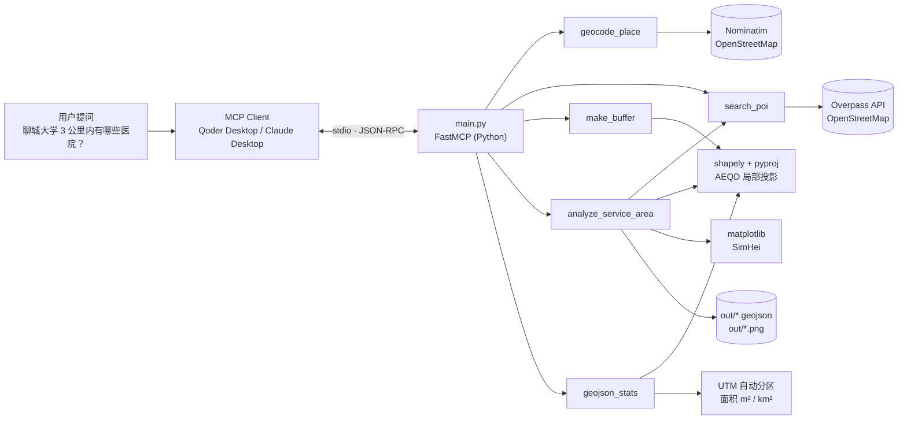
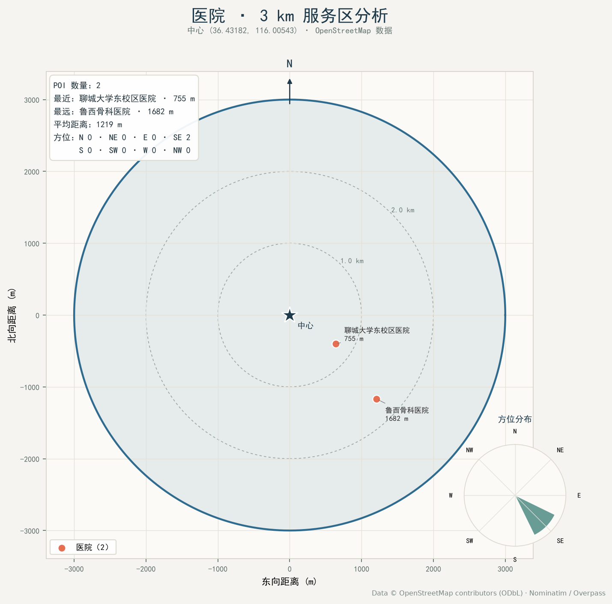

# giskit-mcp

把 GIS 能力封装成 MCP 工具，让大模型在对话里完成地理编码、POI 检索、缓冲区分析和服务区制图。

**5 个工具 · stdio 传输 · 本地空间分析 · 纯开源栈 · 不依赖商业 license**

## 为什么做这个

很多 “GIS + MCP” 示例只是把在线地图服务的内容检索包一层：搜图层、取属性表、看字段，不碰几何，也不做空间分析。

`giskit-mcp` 把真正的地理计算放在本地：

- 用 `shapely` + `pyproj` 做测地缓冲、UTM 投影面积统计；
- 用 OpenStreetMap 的 Nominatim 做地理编码、Overpass 做周边 POI；
- 用 `matplotlib` 生成带中文标注、方位玫瑰图和 OSM 署名的服务区地图；
- 所有工具通过 MCP 暴露，模型可以自主决定先地理编码、再检索、再分析。

它适合作为 GIS × LLM 方向的作品集项目，也适合用来演示 MCP 的工具编排、错误处理、公共 API 限流和空间分析工程化。

## 架构



纯文本版：

```text
Qoder / Claude Desktop
        │  stdio (JSON-RPC)
        ▼
  main.py  (FastMCP)
   ├── geocode_place ──────────> Nominatim (OSM)
   ├── search_poi ─────────────> Overpass API (OSM)
   ├── make_buffer ────────────> shapely + pyproj (AEQD)
   ├── analyze_service_area ───> search_poi + buffer + matplotlib ──> out/*.geojson, out/*.png
   └── geojson_stats ──────────> shapely + pyproj (UTM 自动分区)
```

MCP 服务端由客户端以子进程方式启动，使用 stdio，不监听网络端口。

## 工具

| 工具 | 用途 | 关键输入 | 成功返回 | 数据源 / 计算 |
| --- | --- | --- | --- | --- |
| `geocode_place` | 地名/地址 → 经纬度 | `name` | `{lat, lon, display_name}` | Nominatim |
| `search_poi` | 某点周边指定类别 POI，按距离升序 | `category, lat, lon, radius_m` | JSON 数组 `[{name, lat, lon, distance_m}]` | Overpass API |
| `make_buffer` | 生成测地缓冲圆 | `lat, lon, radius_m` | GeoJSON `Polygon`（WGS84） | shapely + pyproj，AEQD |
| `analyze_service_area` | 服务区组合分析 + 出图 | `lat, lon, radius_m, category` | 统计摘要 + `out/*.geojson` + `out/*.png` | Overpass + shapely/pyproj + matplotlib |
| `geojson_stats` | 统计本地 GeoJSON | `path` | 要素数、几何类型、bbox、总面积、UTM 分区 | shapely + pyproj |

只有这 5 个工具，没有额外调试工具。

### 错误约定

所有工具的错误都返回结构化对象，不让裸异常穿透到客户端：

```json
{
  "error": {
    "code": "INVALID_CATEGORY",
    "message": "不支持的类别：火锅店",
    "hint": "可用类别：医院、诊所、药店……；也可传原始 OSM 标签，如 amenity=clinic。"
  }
}
```

`search_poi` 成功时是 JSON 数组文本，失败时是上面的 JSON 对象；为兼容这两种返回，它的 FastMCP structured output 被关闭（否则列表 schema 会拒绝错误对象）。

### 类别

`search_poi` / `analyze_service_area` 的 `category` 支持：

- 中文常用类别：医院、诊所、药店、学校、大学、餐厅、快餐、咖啡、银行、ATM、超市、便利店、商场、公园、酒店、景点、加油站、停车场、公交站、客运站、地铁站、派出所、图书馆；
- 英文别名：`hospital`、`clinic`、`pharmacy`、`school`、`university`、`restaurant`、`bank`、`supermarket`、`park`、`hotel`、`fuel`、`parking`、`bus_stop` 等；
- 原始 OSM 标签：`amenity=clinic`、`shop=supermarket`、`leisure=park` 等（会做安全字符校验）。

POI 半径上限 50 km。大半径 + 密集类别会显著变慢，演示建议 1–5 km。

## 真实演示

### 1. Qoder Desktop 中自主串联工具

提问：

> 聊城大学 3 公里内有哪些医院，按距离排序。

模型自主调用：

1. `geocode_place(name="聊城大学")` → `36.4318169, 116.005428`（OSM 匹配到聊城大学东校区）
2. `search_poi(category="医院", lat=36.4318169, lon=116.005428, radius_m=3000)`

返回表格：

| 名称 | 距离(m) | 纬度 | 经度 |
| --- | ---: | ---: | ---: |
| 聊城大学东校区医院 | 755.2 | 36.4282044 | 116.0125651 |
| 鲁西骨科医院 | 1682.4 | 36.421279 | 116.0189161 |

完整会话记录（含原始工具输出）：[docs/e2e-qoder.md](docs/e2e-qoder.md)。

> OSM 数据随时间变化；“聊城大学”在 OSM 中拆分为东/西校区，地理编码可能返回其中一个校区。上表是 2026-11-16 的真实结果，换时间/换网络后数量可能不同。

### 2. 服务区分析出图

调用：

```json
{
  "lat": 36.4318169,
  "lon": 116.005428,
  "radius_m": 3000,
  "category": "医院"
}
```

生成 `out/service_area_hospital_3000m_<时间戳>.geojson` 和同名 `.png`：



再用 `geojson_stats` 复核同一份 GeoJSON：

```json
{
  "feature_count": 4,
  "geometry_types": ["Point", "Polygon"],
  "bbox": [115.9719718, 36.4047818, 116.0388842, 36.4588519],
  "area_m2": 28254418.17,
  "area_km2": 28.254418,
  "utm_zone": "50N"
}
```

4 个要素 = 中心点 + 缓冲面 + 2 家医院；面积应为 π × 3² ≈ 28.274 km²，UTM 50N 投影后算得 28.254 km²（AEQD 圆 + UTM 投影误差约 0.07%）。

示例产物已复制到：

- [docs/service_area_example.geojson](docs/service_area_example.geojson)
- [docs/service_area_map.png](docs/service_area_map.png)

### 3. Inspector 工具发现

```bash
npx @modelcontextprotocol/inspector --cli .venv/Scripts/python.exe main.py --method tools/list
```

本机真实输出已保存为 [docs/inspector-tools.json](docs/inspector-tools.json)，恰好 5 个工具。

## 快速开始（5 分钟）

### 1. 准备 Python

需要 Python 3.11+，本项目在 Python 3.12.10 上验证。

```bash
python --version
```

如果 `python` 打开的是 Microsoft Store 而不是真实解释器，请安装 python.org 的 Python，或使用完整解释器路径。

### 2. 创建环境并安装依赖

```bash
cd gis-mcp
python -m venv .venv

# PowerShell
.\.venv\Scripts\Activate.ps1
# Git Bash
# source .venv/Scripts/activate
```

```bash
pip install -r requirements.txt
```

镜像建议（按你的网络选择）：

```bash
# 清华镜像（优先）
pip install -i https://pypi.tuna.tsinghua.edu.cn/simple -r requirements.txt

# 如果清华镜像返回 403，可换阿里云
pip install -i https://mirrors.aliyun.com/pypi/simple/ -r requirements.txt
```

> `requirements.txt` 锁定 `mcp[cli]==1.30.0`。mcp 2.x 已把 `FastMCP` 改名为 `MCPServer`，并让 `mcp.server.fastmcp` 直接报错；本项目保留 FastMCP 路径，所以固定在 1.x。

### 3. 本机冒烟测试

```bash
./.venv/Scripts/python.exe scripts/client.py list
./.venv/Scripts/python.exe scripts/client.py call geocode_place '{"name": "聊城大学"}'
```

`scripts/client.py` 是一个最小 MCP stdio 客户端：启动服务端、完成 initialize、列工具或调用工具。它只用于本地验收，不会进入 MCP 工具列表。

### 4. 接入 Qoder Desktop

在 Qoder 的 **设置 → MCP 连接器** 中添加自定义 MCP（或使用同等配置）：

```json
{
  "mcpServers": {
    "giskit-mcp": {
      "command": "C:\\Users\\<you>\\Documents\\Qoder\\gis-mcp\\.venv\\Scripts\\python.exe",
      "args": [
        "C:\\Users\\<you>\\Documents\\Qoder\\gis-mcp\\main.py"
      ],
      "env": {
        "PYTHONUTF8": "1"
      },
      "timeout": 120000
    }
  }
}
```

把 `<you>` 换成你的用户目录。macOS / Linux 使用 `.venv/bin/python`。保存后重连 MCP，并新开一个会话让工具列表刷新。

仓库不包含任何客户端配置文件；Qoder 的具体入口名称可能随版本变化，核心是添加一个 stdio 类型的自定义 MCP，命令指向项目虚拟环境里的 Python。

### 5. 接入 Claude Desktop（可选）

配置文件：

- Windows：`%APPDATA%\Claude\claude_desktop_config.json`
- macOS：`~/Library/Application Support/Claude/claude_desktop_config.json`

同样是 `mcpServers` 结构，`command`/`args` 换成你的绝对路径，重启 Claude Desktop。

### 6. MCP Inspector（可选）

需要 Node.js。Inspector v2 要求 Node `^22.23.4` 或 `^24.22.1`。

```bash
# 脚本化检查（推荐用于验收）
npx @modelcontextprotocol/inspector --cli .venv/Scripts/python.exe main.py --method tools/list

# Web UI
npx @modelcontextprotocol/inspector .venv/Scripts/python.exe main.py
```

## 验收命令

以下命令在项目根目录、Git Bash 中执行。PowerShell 用户请注意 JSON 引号转义。

### 工具列表

```bash
./.venv/Scripts/python.exe scripts/client.py list
```

### 地理编码

```bash
./.venv/Scripts/python.exe scripts/client.py call geocode_place '{"name": "聊城大学"}'
```

真实结果：

```json
{
  "lat": 36.4318169,
  "lon": 116.005428,
  "display_name": "聊城大学东校区, 1, 聊城大学东校区后街, 东城街道, 东昌府区, 聊城市, 山东省, 252000, 中国"
}
```

### 缓冲区 + 统计（纯本地）

```bash
./.venv/Scripts/python.exe scripts/client.py call make_buffer \
  '{"lat": 36.4318169, "lon": 116.005428, "radius_m": 3000}' > out/demo_buffer.geojson

./.venv/Scripts/python.exe scripts/client.py call geojson_stats \
  '{"path": "out/demo_buffer.geojson"}'
```

预期面积约 28.25 km²，UTM 分区 50N。

### POI 检索

```bash
./.venv/Scripts/python.exe scripts/client.py call search_poi \
  '{"category": "医院", "lat": 36.4318169, "lon": 116.005428, "radius_m": 3000}'
```

真实结果（2026-11-16）：

```json
[
  {
    "name": "聊城大学东校区医院",
    "lat": 36.4282044,
    "lon": 116.0125651,
    "distance_m": 755.2
  },
  {
    "name": "鲁西骨科医院",
    "lat": 36.421279,
    "lon": 116.0189161,
    "distance_m": 1682.4
  }
]
```

### 服务区分析

```bash
./.venv/Scripts/python.exe scripts/client.py call analyze_service_area \
  '{"lat": 36.4318169, "lon": 116.005428, "radius_m": 3000, "category": "医院"}'
```

会返回统计摘要和 `out/service_area_hospital_3000m_<时间戳>.geojson` / `.png` 两个路径。

交叉复核：

```bash
GEO=$(ls -t out/service_area_*.geojson | head -1)
./.venv/Scripts/python.exe scripts/client.py call geojson_stats "{\"path\": \"$GEO\"}"
```

## 数据源与使用政策

这个项目只使用开放数据，不接付费 API，不爬取需要登录的站点。

### Nominatim（OSM 地理编码）

- 每次请求带自定义 `User-Agent`，默认 `giskit-mcp/0.1 (local GIS MCP demo)`；
- 实现 1.1 秒最小请求间隔，串行化请求；
- 不做批量地理编码 / 自动补全；
- 部署到公网或多人使用前，请设置 `GISKIT_USER_AGENT` 为能联系到你的标识；
- 默认使用 `https://nominatim.osm.org/search`。部分网络会把 `nominatim.openstreetmap.org` DNS 污染，`osm.org` 是官方别名；如果该别名也不可达，可用 `NOMINATIM_URL` 指向你自建/合规的 Nominatim；
- 数据 © OpenStreetMap contributors，ODbL。

### Overpass API（OSM POI）

- 单次查询在 Overpass QL 内设置 `[timeout:25]`，HTTP 读超时 25 秒；
- 每个端点失败自动重试 1 次；仍失败则切换备用端点；
- 1.1 秒最小请求间隔；
- 相同类别 + 中心点 + 半径的查询做 5 分钟内存缓存（上限 32 条）；
- 默认优先官方 dev 节点 `https://dev.overpass-api.de/api_drolbr/interpreter`，主站 `https://overpass-api.de/api/interpreter` 作为兜底。这是当前网络下主站经常容量已满（502/超时）的工程选择；低调用量演示可用，**不要**把它当生产服务；
- 可用 `OVERPASS_URL` 覆盖为自建 Overpass 或你信任的公共实例；
- 公共实例有配额和公平使用要求，请不要高频、批量或大半径查询。

### 其他

- 缓冲区、UTM 面积、方位统计、制图全部在本地完成，不发送地名之外的用户数据到第三方；
- 地图 PNG 和 GeoJSON 元数据都带 OSM 署名；
- 代码 MIT，数据 ODbL，二者不要混淆。

## 关键实现

### 测地缓冲：AEQD 而不是经纬度直接 buffer

`make_buffer` 以圆心建立局部方位等距投影（AEQD），在投影平面内生成 64 段/象限的圆，再反投影回 WGS84。城市尺度下圆是近似测地的，避免在经纬度坐标里直接 `buffer` 造成的形状/距离误差。

### 面积：按中心经度自动选 UTM

`geojson_stats` 读取 FeatureCollection / Feature / Geometry，把所有要素的 bbox 中心经度换算成 UTM 分区（本项目聊城为 50N），用 pyproj 投影后求面积和。多个面重叠时按要素累加；跨多个 UTM 分区的大范围数据会有投影误差，这一点写进了 docstring。

### 方位分布

`analyze_service_area` 在 AEQD 平面里用 `atan2(dx, dy)` 计算方位角，按 N/NE/E/SE/S/SW/W/NW 八个 45° 扇区统计。0° 为北，顺时针增加。

### 出图

- 字体：优先 SimHei，失败回退 Microsoft YaHei / Noto Sans CJK / Arial Unicode MS；
- `axes.unicode_minus = False`，负号不会显示成方块；
- 图上包含 1/3、2/3 半径圈、最近 5 个 POI 标注、统计框、八方位玫瑰图、OSM 署名；
- 地图和 GeoJSON 使用同一份缓冲几何与 POI 坐标，避免“图上一个样、数据另一个样”。

### 工具契约

- 每个工具的 docstring 都写清用途、参数、成功/失败返回，供模型阅读；
- 所有运行期错误（网络、限流、文件、几何、参数）统一转成 `{"error": {...}}`；
- POI 查询按 geodesic 距离排序，而不是平面欧氏距离；
- 未命名 POI 用 `类别 #类型/id` 作为名字，避免空字符串。

## 项目结构

```text
gis-mcp/
├── main.py                       # FastMCP server + 5 个工具
├── requirements.txt              # 固定版本
├── scripts/
│   └── client.py                 # 最小 MCP stdio 客户端（验收用）
├── docs/
│   ├── e2e-qoder.md              # Qoder 端到端会话记录
│   ├── inspector-tools.json      # Inspector tools/list 真实输出
│   ├── service_area_example.geojson
│   └── service_area_map.png
├── out/                          # 运行产物（gitignored）
├── .gitignore
├── LICENSE
└── README.md
```

## 已知限制

- OSM 是众包数据，POI 覆盖不完整；医院数量少不代表周边没有医院。生产场景应接权威 POI 数据源。
- “聊城大学”在 OSM 中拆成东/西校区，地理编码会选其中一个；3 km 结果会随之变化。
- UTM 面积按整体 bbox 中心选一个分区，跨分区大数据会有误差；多面重叠按要素累加，不去重。
- AEQD 缓冲适合城市尺度；超大半径（几十公里以上）需要更严格的测地缓冲方案。
- POI 半径上限 50 km；公共 Overpass 实例可能繁忙或限流。
- 不含 Web 前端、数据库、用户鉴权，也不接超图 iServer（无商业 license）。
- 本项目面向学习和演示，不承诺公共 API 的 SLA。


## License

代码：[MIT](LICENSE)

数据：© OpenStreetMap contributors，[ODbL](https://www.openstreetmap.org/copyright)

本项目与 OpenStreetMap、Nominatim、Overpass API、Qoder、Anthropic 均无隶属关系。
